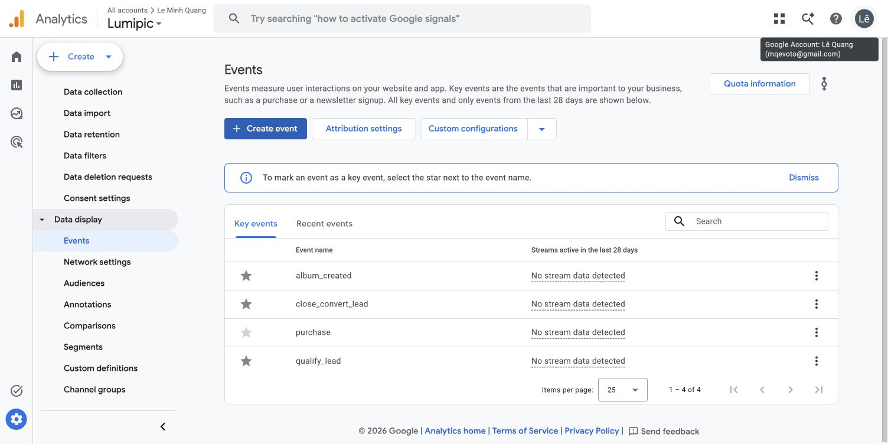
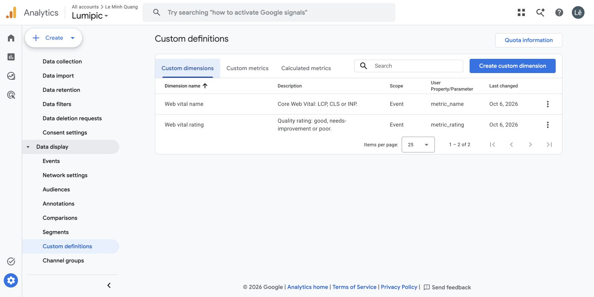
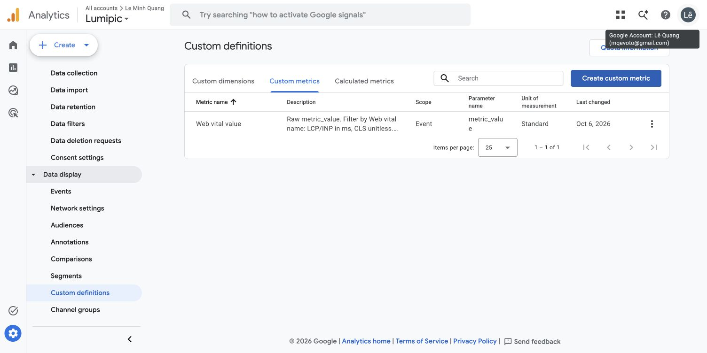
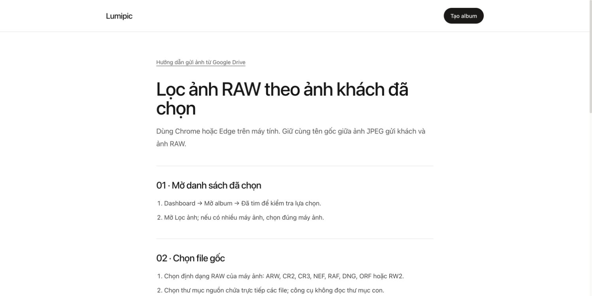

# Triển khai các đề xuất SEO — 06/10/2026

## Phạm vi và trạng thái

Đã sửa source frontend, cập nhật cấu hình Nginx mẫu trong backend và cấu hình đo lường trong GA4 thật. Chưa commit/push/deploy phiên bản này. Kiểm tra HTTP production cuối phiên vẫn thấy trang chủ chứa `noindex,nofollow` và root rỗng; không coi lỗi live đã được sửa trước khi deploy.

## Trang chủ và khả năng index

- Prerender xuất trang chủ thẳng vào `dist/index.html`, có nội dung, đúng một H1/canonical, robots index, metadata chia sẻ và WebSite schema.
- Khung ứng dụng riêng tư được lưu vào `dist/app.html`, vẫn noindex; dashboard rewrite về app.html. Không bỏ noindex khỏi mọi trang ứng dụng.
- Bỏ rewrite root sang home.html; chuẩn hóa /index.html và /home.html về /. Vercel, Vite preview và cấu hình Nginx dùng cùng cách tổ chức file.
- Ba bài mới được prerender: `/huong-dan/loc-anh-raw`, `/huong-dan/chon-anh-tren-dien-thoai`, `/huong-dan/loi-google-drive`. Nội dung dựa trên tính năng đang có, dùng lại ảnh chụp album local, không thêm tính năng giả định.
- Trang chủ và các bài có liên kết thật tới hướng dẫn liên quan. Sitemap có 7 URL công khai, không có dashboard/album.
- Giữ trang 404 thật và FAQ đầy đủ trong HTML. Giữ title/H1 đã được duyệt.

## Mobile và hiệu năng

- Cho phép zoom trong viewport.
- Trang chủ dùng font hệ thống sẵn có trong CSS; bỏ yêu cầu Google Fonts không sử dụng trên trang này. Các trang còn lại giữ font hiện có.
- Dùng Vite manifest thêm modulepreload cho entry hydration công khai và các import cần thiết, để bắt đầu tải ngay khi phân tích HTML. Không preload bundle dashboard.
- Rà soát theo Vercel React Best Practices: một component mỗi file; nội dung hướng dẫn tĩnh; ảnh lazy có width/height/alt; liên kết điều hướng có href; cây hydration dùng cùng PublicPage với prerender.
- Kiểm tra bài hướng dẫn ở viewport điện thoại: không tràn ngang, một H1. Preview homepage có lỗi kết nối API do preview không proxy backend; không thấy lỗi hydration từ ứng dụng trong các log đã đọc. Cảnh báo extension trình duyệt được tách khỏi lỗi ứng dụng.
- Chưa đo lại PageSpeed production cho bản sửa. Không suy ra điểm tốc độ/thứ hạng mới từ source. Baseline đã đo trước đây: trang chủ Performance 78, LCP 4,7 s, TBT 210 ms; hướng dẫn Drive Performance 100, LCP 1,5 s, TBT 20 ms. Cả hai chưa có CrUX.

## GA4 thật

Property Lumipic 557674306; stream Lumipic Website, Measurement ID G-DQ2K1W0FF0.

- Stream xác nhận nhận dữ liệu trong 48 giờ gần nhất; Enhanced measurement đang tắt.
- Đã đăng ký `album_created` làm key event, đếm mỗi sự kiện, không gán giá trị tiền tệ; dùng event gửi bởi source, không tạo event từ page_view.
- Đã tạo dimensions scope Event: Web vital name → metric_name; Web vital rating → metric_rating.
- Đã tạo metric Standard: Web vital value → metric_value. Phải lọc theo metric_name: LCP/INP ms, CLS không đơn vị. Không cộng/gộp cả ba. Phân tích p75 cần giá trị cuối theo metric_id và dữ liệu đủ mẫu; metric_id không đăng ký dimension để tránh cardinality cao.
- Chưa có bằng chứng album_created thật đã được GA4 xử lý; không tạo album production giả để sinh conversion.
- Xem Traffic acquisition → Organic Search → key event album_created. Báo cáo cần dữ liệu thực tế và thời gian xử lý; cấu hình xong không đồng nghĩa đã có hiệu quả SEO.





## Search Console đang chờ xác nhận tài khoản

Tài khoản Google đang mở: mqevoto@gmail.com. Đã chuẩn bị Domain property lumipic.space và màn hình TXT, chưa thêm DNS/chưa hoàn tất Verify. Đã hỏi người dùng chọn tài khoản sở hữu vì xác minh cấp quyền quản lý dữ liệu tìm kiếm của tên miền cho tài khoản đó. Không cấp quyền DNS cho Google qua luồng tự động GoDaddy.

TXT do Google cấp cho tài khoản hiện tại:

```text
google-site-verification=JfzXZQEghG1XOCxRf55nnxBd0HSfpq2B5i7TILLRUpI
```

Chỉ dùng bản ghi này nếu xác nhận đúng tài khoản; tài khoản khác phải lấy bản ghi của tài khoản đó. DNS host @/root, không ghi đè TXT khác.

Sau khi xác minh và deploy bản sửa:
1. Kiểm tra response HTML / không noindex, có H1/canonical; dashboard vẫn noindex; URL lạ 404.
2. Gửi https://lumipic.space/sitemap.xml trong Sitemaps.
3. URL Inspection → Test live URL cho / và 4 bài hướng dẫn → Request indexing nếu cần.
4. Liên kết Search Console với GA4 khi cùng tài khoản có đủ quyền.
5. Theo dõi Pages và Performance trong Search Console; organic và album_created trong GA4. Đo PageSpeed mobile lại cho trang chủ và hướng dẫn, tách lab khỏi dữ liệu người dùng thật.

Không thể gửi sitemap, yêu cầu index hay liên kết GA4 khi property chưa được xác minh. Chưa có chứng cứ thứ hạng tăng hoặc các URL mới được Google index.

## Kiểm tra bản build

- pnpm build: đạt, prerender 7 trang công khai.
- pnpm test:seo: đạt 2 nhóm kiểm tra, gồm đọc file index/app trực tiếp và HTTP preview: H1, canonical, noindex, metadata, FAQ, ảnh, liên kết bài, redirects, sitemap/robots, 404 và private routes.
- pnpm test: đạt 31 kiểm tra. Cảnh báo fetchPriority của Lightbox đã tồn tại, ngoài phạm vi SEO.
- git diff --check: đạt.



Các hoạt động xây dựng uy tín bên ngoài như bài chia sẻ studio, backlink và hồ sơ thương hiệu cần nội dung thực tế và tài khoản xuất bản; chưa đăng bài/nhắn tin đến bên thứ ba trong phiên này.
