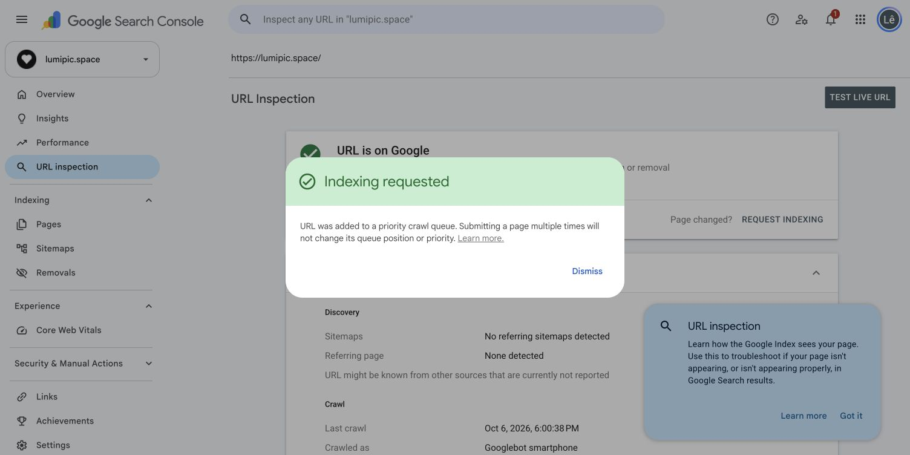
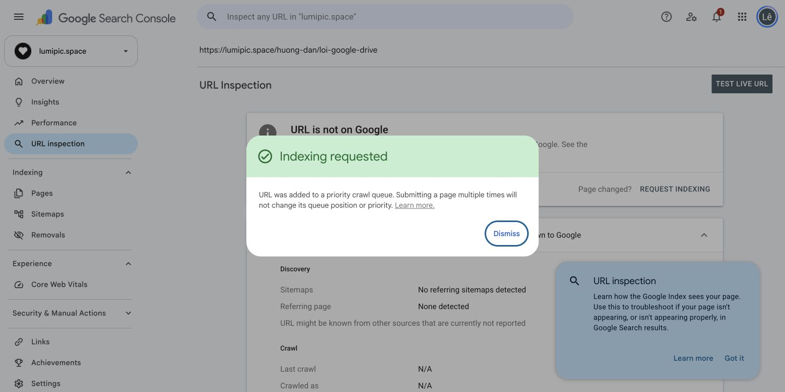
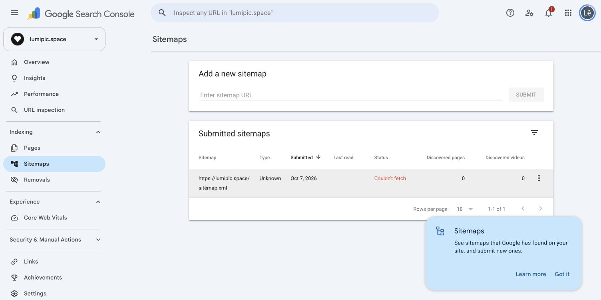

# Kiểm tra SEO sau deploy — 07/10/2026

## HTTP production

Đã kiểm tra trực tiếp 15 URL, không dùng HTML sau khi React chạy để suy ra HTML ban đầu.

- `/` và `/?utm_source=audit`: 200, HTML có nội dung, một H1 và canonical https://lumipic.space/, không meta/header noindex. Title đúng bản đã duyệt, FAQ đầy đủ, WebSite schema, Open Graph, 4 liên kết bài hướng dẫn và modulepreload.
- 4 bài hướng dẫn, privacy, terms: 200, một H1/canonical đúng, không noindex.
- `/dashboard` và `/app.html`: 200, SPA shell riêng tư, meta và X-Robots-Tag noindex/nofollow, không canonical công khai.
- `/index.html`, `/home.html`: 308 về `/`.
- `/missing-seo-audit`: HTTP 404 thật, trang lỗi noindex.
- `/robots.txt`: 200, cho phép crawl công khai, chỉ chặn API, trỏ sitemap đúng.
- `/sitemap.xml`: 200, application/xml, parse XML thành công, 7 URL. Googlebot user-agent cũng trả 200. User-agent giả lập không chứng minh các IP Google thật truy cập được.

Bằng chứng: [HTTP JSON](seo-live-evidence-2026-10-07/http-results.json), [Googlebot sitemap headers](seo-live-evidence-2026-10-07/googlebot-sitemap.headers), [XML](seo-live-evidence-2026-10-07/googlebot-sitemap.xml).

## Search Console

Property Domain lumipic.space đã truy cập được bằng tài khoản hiện tại. Trang Overview báo dữ liệu Performance/Indexing/Experience đang xử lý.

Trang chủ: URL Inspection xác nhận **URL is on Google / Page is indexed**. Lần crawl được báo là 06/10/2026 18:00:38, Googlebot smartphone, fetch thành công, cho phép index; canonical người dùng lúc crawl đó là None. Đây là dữ liệu lịch sử, không phải bằng chứng Google đã crawl bản deploy mới có canonical. Đã gửi Request indexing để cập nhật bản mới; Google xác nhận URL đã vào hàng đợi ưu tiên.

Cả 4 bài hướng dẫn (gửi ảnh Drive, lọc RAW, chọn trên điện thoại, xử lý lỗi Drive): URL Inspection báo unknown to Google/chưa index tại thời điểm kiểm tra. Đã Request indexing cho từng bài, Google xác nhận cả 4 vào hàng đợi. Yêu cầu index không đảm bảo sẽ được index hay tăng thứ hạng.

Sitemap: trước phiên này chưa có sitemap trong danh sách. Đã gửi https://lumipic.space/sitemap.xml và thử gửi lại một lần sau khi kiểm tra HTTP/XML thành công. Cả hai lần Google báo gửi thành công, nhưng trạng thái bảng vẫn **Couldn't fetch**, type Unknown, 0 trang phát hiện. Không coi sitemap đã được Google đọc thành công. Chưa có bằng chứng xác định nguyên nhân (HTTP trực tiếp và request index hoạt động). Cần kiểm tra lại lần đọc tiếp theo; nếu còn lỗi, đối chiếu log hosting/WAF và DNS, không sửa XML hay bỏ noindex trang riêng tư chỉ dựa vào trạng thái này.

## PageSpeed mobile production

Đo lúc 10:16 GMT+7 ngày 07/10/2026. [Báo cáo Google PageSpeed](https://pagespeed.web.dev/analysis/https-lumipic-space/f86vuektyf?form_factor=mobile). Lighthouse 13.5.0, Moto G Power giả lập, Slow 4G, một lần tải trang:

| Chỉ số | Trước (06/10 21:20) | Sau deploy |
|---|---:|---:|
| Performance | 78 | 87 |
| LCP | 4,7 s | 3,8 s |
| TBT | 210 ms | 60 ms |
| CLS | 0 | 0 |
| Accessibility | 90 | 96 |
| SEO Lighthouse | 100 | 100 |

FCP hiện 1,7 s, Speed Index 2,8 s, Best Practices 96. Chưa có dữ liệu CrUX. Điểm lab có biến động, không chứng minh riêng một thay đổi gây cải thiện và không tương đương thứ hạng tìm kiếm. LCP vẫn cần cải thiện.

Các mục còn được PageSpeed chỉ ra: unused JS ~111 KB, CSS ~12 KB, 3 tác vụ dài; H1 là phần tử LCP, element render delay 1.440 ms trong breakdown. Contrast còn một số mục. Console báo 401 từ `/api/me` ở phiên chưa đăng nhập; chưa kết luận đây là lỗi người dùng.

## Giới hạn

Không có dữ liệu đủ để kết luận organic traffic, CTR, conversion hay thứ hạng đã tăng. Không thay source/deploy trong phiên kiểm tra này. Chưa thiết lập lịch giám sát tự động vì người dùng chưa yêu cầu.
