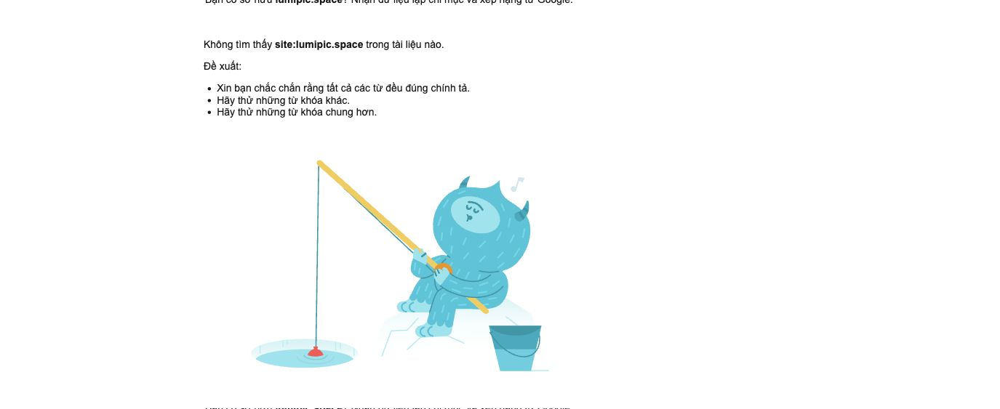

# Đánh giá khả năng SEO và xuất hiện trên Google — Lumipic

Kiểm tra lại ngày 06/10/2026, khoảng 21:47–21:52, giờ Việt Nam. Phạm vi: HTTP của 27 URL live, HTML gốc và Google Search trực tiếp trên desktop, ngôn ngữ Việt. Phiên Google có cá nhân hóa; kết quả có thể khác theo tài khoản, vị trí và thời điểm. Không sửa code/deployment trong lần đánh giá này.

## Kết luận

Khả năng tìm thấy **lumipic.space** hiện còn yếu. Nguyên nhân kỹ thuật rõ nhất vẫn là homepage trả HTML có `noindex,nofollow` và React shell rỗng. Bài hướng dẫn có nền tảng kỹ thuật tốt, nhưng chưa tìm thấy tên miền trong các kết quả Google đã quan sát. Chưa có dữ liệu Search Console để xác nhận chính xác trạng thái index, lượt hiển thị hay vị trí trung bình.

Không chấm điểm SEO tổng hợp tùy ý: indexability, mức độ xuất hiện và khả năng cạnh tranh từ khóa là ba vấn đề khác nhau.

## Kết quả tìm kiếm quan sát trực tiếp

| Truy vấn Google | Quan sát |
| --- | --- |
| `site:lumipic.space` | Google hiển thị “Không tìm thấy site:lumipic.space trong tài liệu nào.” |
| `Lumipic` | Không thấy lumipic.space trong trang kết quả đã đọc; thấy Lumepic, ứng dụng LumiPic trên App Store, Lumipic Pro, dự án LumiPic trên GitHub/Hugging Face và các tên khác |
| `Lumipic Google Drive` | Không thấy lumipic.space trong trang kết quả đã đọc; kết quả chủ yếu không đúng sản phẩm của bạn |
| `phần mềm cho khách chọn ảnh Google Drive` | Không thấy lumipic.space trong nhóm kết quả đã đọc; có S2 Photo Picker, Albumse và nội dung về UWIX/ChonAnh |

Đây là quan sát trên một phiên, không phải báo cáo thứ hạng toàn thị trường. Không tìm thấy với `site:` không đủ kết luận “0 URL đã index”; Google nói danh sách này có thể không đầy đủ. Cần URL Inspection trong Search Console để xác nhận. [Google về toán tử site](https://developers.google.com/search/docs/monitor-debug/search-operators/all-search-site).

## Đánh giá kỹ thuật hiện tại

| Nhóm | Đánh giá | Bằng chứng |
| --- | --- | --- |
| Homepage | Chưa sẵn sàng cho index | HTTP 200 nhưng meta robots noindex,nofollow; 0 H1, 0 canonical, không nội dung/link/FAQ/WebSite/OG trong HTML gốc |
| Bài hướng dẫn | Đủ nền tảng để được crawl/index | HTTP 200, index,follow, HTML prerender, một H1/canonical, title/description riêng, link href và metadata chia sẻ |
| Robots/sitemap | Đúng | robots.txt trả text/plain; sitemap XML chứa 4 URL public |
| Trang riêng tư | Đúng trong mẫu kiểm tra | Dashboard có noindex trong HTML và X-Robots-Tag |
| URL lạ/alias | Đúng trong mẫu kiểm tra | HTTP 404 thật; alias HTML và trailing slash trả 308 về canonical |
| Favicon/ảnh chia sẻ | Đúng | URL ổn định, HTTP 200 và đúng Content-Type |
| Đo lường | Có nền tảng, chưa đủ dữ liệu đánh giá tăng trưởng | Lần audit trước xác nhận page_view GA4 nhận HTTP 204; chưa đọc báo cáo Organic Search hoặc Search Console |

Homepage đang nhận đúng cùng bundle `index-XQPHOtaR.js` như lần audit trước. Sau JavaScript, giao diện/metadata được bổ sung, nhưng điều đó không xử lý được noindex trong HTML gốc: Google có thể bỏ qua render khi đọc noindex. [Google về JavaScript SEO](https://developers.google.com/search/docs/crawling-indexing/javascript/javascript-seo-basics).

### Hiệu năng đã đo gần nhất, cùng ngày/cùng bundle

Không chạy lại Lighthouse trong lần đánh giá này; dùng kết quả đo 21:20–21:23 trong audit trước:

| Mobile lab | Homepage | Hướng dẫn |
| --- | --- | --- |
| Performance | 78 | 100 |
| LCP | 4,7 s | 1,5 s |
| TBT | 210 ms | 20 ms |
| CLS | 0 | 0 |
| Lighthouse SEO | 100 | 100 |

SEO 100 là kiểm tra tự động sau render, không phải điểm thứ hạng hoặc bảo đảm Google index. CrUX chưa có dữ liệu. Ưu tiên sửa root trước khi phân tích hồi quy hiệu năng; không đủ bằng chứng quy lỗi cho GA4.

[Báo cáo homepage](https://pagespeed.web.dev/analysis/https-lumipic-space/yjb4me2213?form_factor=mobile), [báo cáo hướng dẫn](https://pagespeed.web.dev/analysis/https-lumipic-space-huong-dan-gui-anh-google-drive/hqpgwhwj6b?form_factor=mobile).

## Khả năng cạnh tranh nội dung và thương hiệu

- **Định vị sản phẩm rõ:** chọn ảnh từ Google Drive cho nhiếp ảnh gia/khách hàng. Title, mô tả và bài hướng dẫn bám đúng nhu cầu thực tế.
- **Nội dung còn ít:** bốn URL sitemap gồm homepage, một bài hướng dẫn và hai trang pháp lý. Chưa bao phủ nhiều tình huống sử dụng có thể tìm kiếm.
- **Tên thương hiệu dễ bị lẫn:** kết quả “Lumipic” có nhiều sản phẩm trùng/gần tên. Đây là quan sát tìm kiếm, không phải kết luận pháp lý về thương hiệu. Cần dùng nhất quán Lumipic + mô tả chức năng + lumipic.space trong website và các hồ sơ giới thiệu.
- **Đã có cạnh tranh theo chủ đề:** S2/Albumse và các trang giới thiệu công cụ khác đang xuất hiện với truy vấn sản phẩm trong phiên kiểm tra. Chưa đo volume, độ khó từ khóa hay backlink; không khẳng định từ khóa ít cạnh tranh hoặc hứa thời gian lên top.

## Thứ tự triển khai đề xuất

1. **P0 — Sửa cách Vercel phục vụ `/`.** Trả homepage prerender trực tiếp, tách SPA shell riêng cho dashboard; giữ noindex ở trang riêng tư. Kiểm tra HTTP production: homepage phải có index,follow, H1, canonical, FAQ, WebSite và nội dung trước JavaScript. Không chỉ đổi meta bằng React.
2. **P0 — Xác minh Search Console sau sửa.** Gửi sitemap; URL Inspection của `/` và bài hướng dẫn → Test live URL → Request indexing. Ghi rõ lý do loại trừ nếu Google chưa index. Không yêu cầu index dashboard/album khách.
3. **P1 — Đo và tối ưu mobile.** Đo lại cùng điều kiện sau khi root phục vụ đúng HTML; phân tích font/CSS chặn render, JS chưa dùng và main-thread tasks nếu LCP vẫn chậm.
4. **P1 — Mở rộng nội dung theo nhu cầu thực.** Giữ bài hiện tại ngắn, có ảnh. Bổ sung các bài riêng cho “lọc ảnh RAW theo danh sách khách chọn”, “khách chọn ảnh trên điện thoại không cần đăng nhập”, “Google Drive không hiện ảnh trong album”. Mỗi bài cần giải quyết đúng một vấn đề, dùng UI thật, liên kết đến bài liên quan và CTA thích hợp; không kéo dài hoặc nhồi từ khóa chỉ để SEO.
5. **P2 — Củng cố nhận diện và uy tín.** Giới thiệu Lumipic nhất quán trên hồ sơ studio/nhiếp ảnh gia, có demo/case sử dụng thật và link về trang sản phẩm khi phù hợp. Chưa có dữ liệu để kết luận backlink hiện tại mạnh hay yếu.
6. **P2 — Theo dõi hiệu quả.** Search Console: index, impressions, clicks, CTR và vị trí theo query/page; GA4: Organic Search và key event album_created. GA4 page_view không chứng minh người dùng đến từ Google Search.

Mục tiêu đầu tiên: homepage đủ điều kiện index, sau đó kiểm tra khả năng tìm thấy tên miền bằng truy vấn thương hiệu. Mục tiêu tiếp theo: impressions/clicks cho các cụm nhu cầu cụ thể. Không có cơ sở hứa thứ hạng hay thời gian lên top.

## Bằng chứng

- [HTTP kiểm tra lại](seo-live-evidence-2026-10-06/http-results-recheck.json)
- [Audit kỹ thuật trước](seo-live-audit-2026-10-06.md)
- [Trang hướng dẫn live](https://lumipic.space/huong-dan/gui-anh-google-drive)
- [Sitemap live](https://lumipic.space/sitemap.xml)
